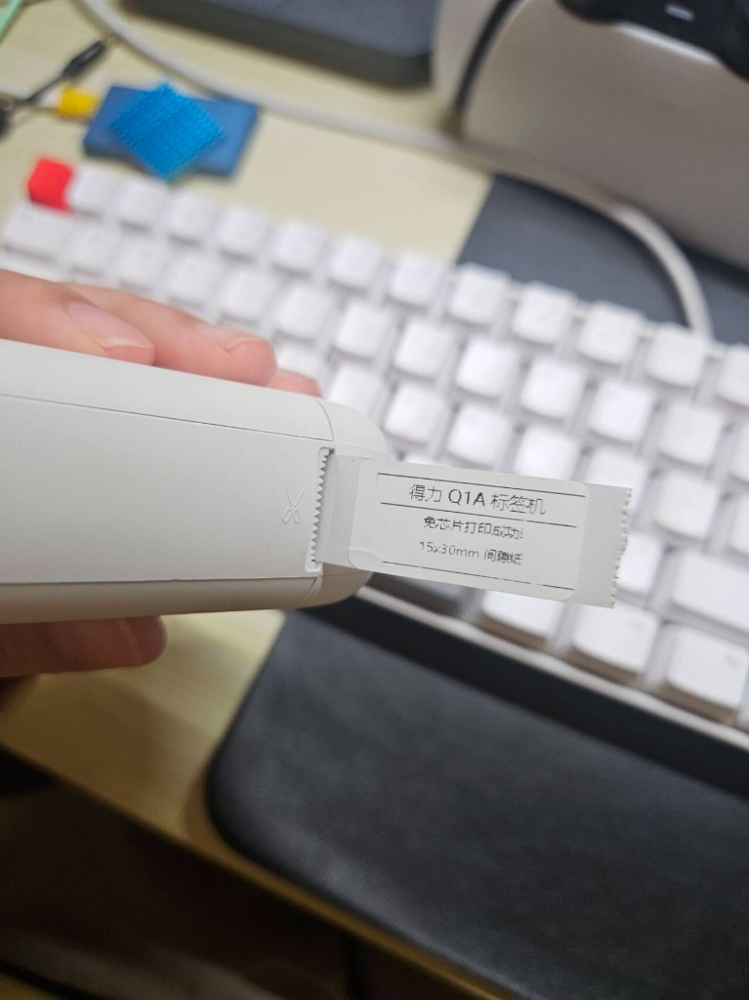
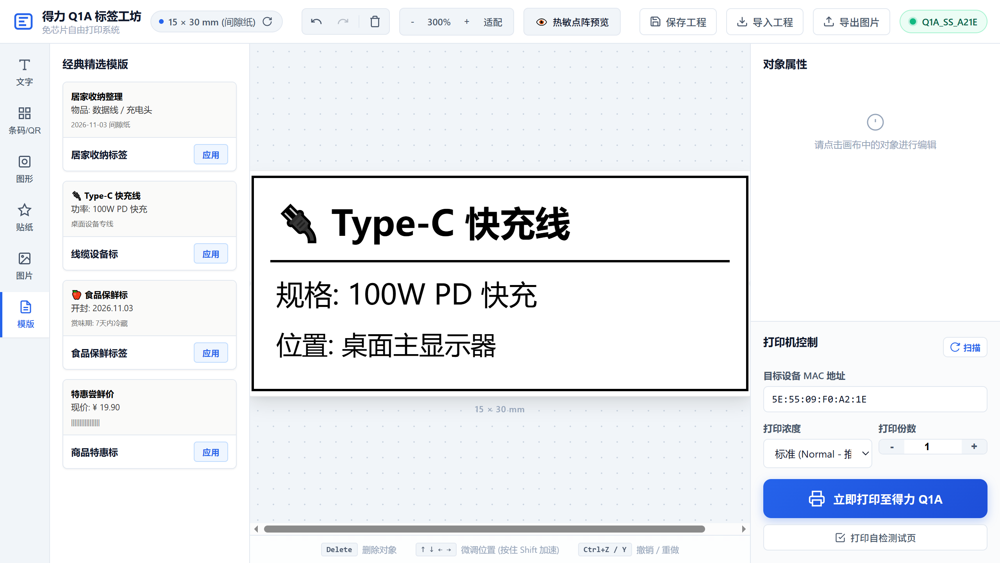

# Deli Q1A 标签打印机协议逆向与免芯片驱动 (Deli Label Printer BLE Driver)

> 彻底告别耗材绑架与 RFID 芯片锁！通过逆向工程得力官方 App 蓝牙通信协议，实现无需官方 App、无需 RFID 芯片、直接通过 PC 蓝牙打印第三方通用热敏标签纸。



## 📁 项目工程架构

本项目采用清晰的三层解耦架构设计，兼顾**极简学习移植**与**丰富应用体验**：

```
deli-q1a-printer/
├── core/                       # 🌟 核心协议与硬件驱动 SDK (纯净轻量，无 Web 依赖)
│   ├── protocol.py             # 底层蓝牙 UUID、控制指令集、光栅管道构造器
│   ├── image.py                # 1-Bit 单色点阵转换与 Floyd-Steinberg 图像算法
│   └── driver.py               # 异步 BLE 驱动引擎 (DeliPrinter)
├── android/                    # 📱 原生 Android 客户端工程 (Kotlin + Material 3)
│   ├── app/src/main/           # 触摸画板、ZXing条码、BLE直连驱动、预置模版
│   └── build.gradle.kts        # 完整 Gradle 构建体系 (compileSdk 34)
├── deli_print.py               # 💻 独立命令行 CLI 工具 (适合脚本自动化与终端打印)
├── server.py                   # 🌐 WebApp 后端服务 (FastAPI REST API)
├── web/                        # 🎨 WebApp 可视化画板前端 (纯浅色优雅交互设计)
│   ├── index.html              # 画布、工具箱、图元检查器与打印控制台
│   └── static/                 # 样式、前端交互引擎与离线 JS 依赖 (Fabric.js, JsBarcode, QRCode)
├── docs/                       # 📚 深度逆向文档与移动端移植指南
│   ├── PROTOCOL.md             # 完整通信协议白皮书与时序规范
│   └── ANDROID_PORTING.md      # Android 原生 App 移植实战指南 (Kotlin 协程实现)
├── assets/                     # 成功打印实物图与 WebApp 预览截图
├── requirements.txt            # 项目依赖
└── README.md                   # 项目使用手册与逆向分析总结
```

---

## 🎨 得力 Q1A 标签工坊 WebApp (可视化画板设计与打印)

除了强大的 Python CLI 命令行驱动，本项目还内置了一套**现代化、轻量优雅的 WebApp 可视化设计工坊**，为广大用户提供如同专业标签机 App 般的交互设计体验！



### 🌟 WebApp 核心特性
- **纯粹浅色优雅界面**：高对比度、符合人机工程学、拟真热敏纸立体质感展示（带切角、尺寸标尺）。
- **完善的画板设计工具**：
  - 📝 **文字系统**：大标题、副标题、小字、多行文本；支持加粗、斜体、下划线、对齐、字号微调与常用中英文字体。
  - 🔳 **条形码 & 二维码**：内置离线 CODE128 条形码引擎与 QR Code 生成器，可自定义显示条码文字。
  - 📐 **几何图形与线条**：实线/虚线分隔线、矩形框、圆角矩形（可调圆角半径）、圆形、全包围外边框。
  - ⭐ **丰富图标与贴纸**：收纳、线缆、食品、易碎品、物流、警示等精美矢量标签图标。
  - 🖼️ **图片上传与拖拽**：支持本地图片一键拖拽上传、任意缩放，内置 Floyd-Steinberg 误差扩散算法抗锯齿。
  - 📂 **精选经典模版**：居家收纳、Type-C 线缆设备、食品保鲜赏味期、特惠价格标签等一键套用。
- **全键盘快捷操作**：
  - `Delete` / `Backspace` 快速删除选中对象
  - `↑ ↓ ← →` 方向键微调位置（按住 `Shift` 键 10 像素加速）
  - `Ctrl + Z` / `Ctrl + Y` 撤销与重做
- **仿真热敏点阵预览**：一键切换 203 DPI 热敏打印头实际黑白点阵烧录效果，所见即所得。
- **本地工程与图片导出**：支持保存为 `.json` 工程文件供下次继续编辑，或导出高清 1:1 PNG 图片。
- **一键直连蓝牙打印**：
  - 自动扫描附近得力打印机并匹配 MAC 地址。
  - 打印浓度可调（浅度 / 标准 / 深度）。
  - 打印份数自由递增（1 ~ 20 份）。
  - 内置“打印自检测试页”快捷按钮。
- **100% 离线运行**：所有前端库（Fabric.js、JsBarcode、QRCode）均已本地打包，无需连接外网即可完全离线运行。

---

## 🚀 启动 WebApp

只需一行命令即可开启图形化设计工坊：

```bash
python server.py
```

服务启动后，系统会自动在默认浏览器打开：
👉 **`http://127.0.0.1:8000`**

---

## 📱 原生 Android 客户端 (得力标签工坊 Android 版)

本项目在 `android/` 目录下提供了 100% 独立的原生 Android Studio 工程，基于现代 Kotlin + Material 3 开发，完全脱离 PC，直接在手机上通过手机蓝牙操控打印机：

* **直连硬件 BLE**：内置 Android 12+ 蓝牙权限管理与 MTU 247 自动协商，支持信号强度智能搜索与默认 MAC 一键直连。
* **触控交互式画板**：单指拖拽排版、双指缩放、富文本调节、ZXing 条形码/二维码生成、图片导入与 Floyd-Steinberg 点阵抖动。
* **一气呵成连续流打印**：将 1-Bit 光栅位图与 `1D 0C` 紧随其后推送到打印机，平滑出纸不顿挫。
* **原生 96×240 物理点阵绝对居中**：完美适配 15×30mm、15×40mm、12×30mm 等耗材规格，绝不截断边框。
* **编译运行**：
  - 用 Android Studio 打开 `android/` 目录直接点击运行即可。
  - 或通过命令行编译：`cd android && ./gradlew assembleDebug`。
  - 详细文档请参见：[android/README.md](android/README.md)。

---

## 📌 项目背景与痛点

很多微型热敏标签机（如**得力 Q1A**、Q1、Q2 系列）采用了“耗材绑定”套路：
1. **强制绑定 RFID/NFC 芯片**：官方标签卷轴内嵌加密 RFID 芯片，内部烧录了打印次数计数器。
2. **锁死第三方耗材**：换用便宜的第三方通用耗材后，App 弹窗拦截：`使用非官方耗材，禁止打印`。
3. **次数耗尽即作废**：即使正版耗材还有纸，只要芯片计数归零，App 同样提示：`超过打印次数，耗材用尽`。

本项目通过完整逆向官方 Android App 与原生底层通信库，彻底揭秘了这一机制，并开发了跨平台 Python 命令行驱动，实现**任意第三方耗材自由打印**！

---

## 🔬 逆向工程揭秘 (Reverse Engineering Journey)

### 第一步：硬件层验证 —— 机器真的“锁死”了吗？

在对通信协议动刀之前，我们先验证了一个关键物理事实：
- **双击电源键自检**：在**不放任何 RFID 芯片**的情况下，连续双击得力 Q1A 电源键，机器**成功吐出了自检测试页**！
- **结论**：硬件主控电路、微型步进电机、热敏打印头和光学间隙传感器在物理层面**完全不依赖芯片**，固件底层并未在硬件级硬编码锁死非官方纸张。

### 第二步：解包官方 App —— 锁究竟下在哪里？

我们获取了官方 App **“得力趣贴贴” (`com.delicloud.app.label`)** 进行深度解包分析：
1. **加固壳识别**：APK 采用梆梆企业加固（`com.secneo.apkwrapper`），但核心底层通信库是以未加密 ELF 动态库（`.so`）形式直接暴露的。
2. **RFID 验签逻辑暴露 (`libdeli-rfid-verify.so`)**：
   - 提取出 JNI 接口：`Java_com_delicloud_library_printsdk_ext_NativeLib_getReleaseSecretKey`
   - 导出公钥：`MDIwEAYHKoZIzj0CAQYFK4EEAAYDHgAEss/PBPlpXxt586pS4ei7ShbbK6EN0f7AVEusbg==`
   - ASN.1 DER 解码证明：这是一个标准的 **`secp160r1` ECDSA 非对称加密公钥**。
   - **真相大白**：打印机把 RFID 标签数据通过蓝牙透传给手机，**验签与打印计数校验全部发生在手机 App 端**！一旦芯片缺失或验签失败，App 直接弹窗 `res/PL.xml`（“使用非官方耗材”），**根本不会往蓝牙发送任何打印数据指令**。硬件本身完全是无辜的。

### 第三步：协议破译 —— 为什么早期尝试完全静音？

在我们早期尝试直接用通用指令（如微赢 Wewin 系列指令）与打印机通信时，打印机蓝牙回复了 `OK`、`FD 01`、`FA 01`，但**机械电机完全不转，整机静音**。

通过对官方底层动态库 `libPrinterNative.so` 进行 Capstone ARM 反汇编，我们发现了关键秘密：
- **得力私有协议安全壳 (`PrintNative_a` / `PrintNative_b`)**：
  官方发送的每一笔打印数据，最外层必须包裹一个 **8 字节固定帧头**：
  $$\text{Frame Header} = \texttt{FF F1 F2 F3 03 02 01 01}$$
  打印机返回的确认帧头为：
  $$\text{Response Header} = \texttt{FF F1 F2 F3 03 02 01 00}$$
- **专属字节映射混淆算法**：
  $$\begin{cases}
  0\text{x}10 \longleftrightarrow 0\text{xFF} \\
  0\text{x}01 \longleftrightarrow 0\text{xF1} \\
  0\text{x}02 \longleftrightarrow 0\text{xF2}
  \end{cases}$$
- **静音原因**：打印机内的 BLE 蓝牙芯片负责处理基础 AT 查询，但主控电机的供电 MOSFET 驱动管受得力私有协议解析器保护。未包裹得力加密帧的数据，电机驱动芯片直接静默丢弃。

### 第四步：协议家族溯源与电机时序调优

进一步逆向 `libPrinterNative.so`，我们在符号表中发现了 `LuckP_D1S`，成功追溯出其核心架构属于 **厦门爱印/力虎 LuckPrinter 协议族**：
1. **启用打印机**：`10 FF F1 03`
2. **唤醒微控制器**：`b'\x00' * 12`
3. **设置打印浓度**：`10 FF 10 00 [density]`（0=浅，1=正常，2=浓）
4. **间隙纸校准定位**：`1F 11 51`
   - 机器首次打印前会自动进纸探测透明间隙，确保打印头与第一张标签起始位置精准对齐。
5. **连续流光栅图像管道传输**：ESC/POS 标准光栅指令 `1D 76 30 00 [wL] [wH] [hL] [hH]`（15×30mm 纸对应 `0C 00 F0 00`，12 字节 $\times$ 240 行）。
6. **紧随定位走纸（一气呵成）**：直接在光栅流末尾追加 `1D 0C`（间隙定位走纸），令打印机固件在电机高速旋转中无停顿过渡到缝标裁切口，彻底避免中途顿挫与卡顿。
7. **退出标签模式并结束作业**：`1F 11 50` + `10 FF F1 45`

---

## 🛠️ 硬件与耗材规格

| 参数项 | 规格说明 |
| :--- | :--- |
| **设备型号** | 得力 (Deli) Q1A 标签打印机 (`Q1A_SS_A21E`) |
| **通信接口** | 蓝牙低功耗 Bluetooth Low Energy (BLE 4.2+) |
| **GATT 特征** | `FF02` (写指令/数据), `FF01` / `FF03` (状态通知接收) |
| **分辨率** | 203 DPI (8 dots/mm，精准值 203 / 25.4 ≈ 7.992) |
| **适用耗材** | 15mm $\times$ 30mm 间隙标签纸 (标准)，兼容 15×40、15×50、12mm 规格 |
| **物理硬件点阵** | **96 dots (12.0mm 硬件发热丝宽, 12 字节/行) $\times$ 240 dots (30.0mm 走纸全长)** |
| **完美居中参数** | 左右各留 10 点（$1.25\text{ mm}$），上下各留 4 点（$0.5\text{ mm}$），边框 $220 \times 88$，四边绝对居中 |

---

## 💻 快速上手

### 1. 环境准备

需要 Python 3.9+ 环境，安装必要依赖：

```bash
git clone https://github.com/cuicui-V5/deli-q1a-printer.git
cd deli-q1a-printer
pip install -r requirements.txt
```

### 2. 搜索附近的打印机

确保打印机开机（指示灯常亮）：

```bash
python deli_print.py --scan
```

控制台会列出所有蓝牙设备，默认 MAC 为 `5E:55:09:F0:A2:1E`。如果是另一台设备，可通过 `--mac <你的MAC>` 指定。

### 3. 打印自定义文字

```powershell
# 打印多行横版文字（自动居中并添加边框）
python deli_print.py --text "收纳盒-数据线\n规格: Type-C\n日期: 2026-11-03"

# 打印竖版文字
python deli_print.py --text "分类标签" --orientation portrait

# 打印多份并去除边框
python deli_print.py --text "样品01" --copies 3 --no-border
```

### 4. 打印图片

支持任意格式图片，自动按比例缩放并应用 Floyd-Steinberg 误差扩散算法抗锯齿：

```powershell
python deli_print.py --image my_logo.png
```

### 5. 生成本地预览图（不耗纸测试）

```powershell
python deli_print.py --text "测试文字" --preview preview.png
```

---

## 📁 命令行参数详解

| 参数 | 类型 | 默认值 | 作用说明 |
| :--- | :--- | :--- | :--- |
| `--text` | `str` | - | 要打印的文本，换行使用 `\n` |
| `--image` | `str` | - | 要打印的图片文件路径 |
| `--mac` | `str` | `5E:55:09:F0:A2:1E` | 打印机蓝牙 MAC 地址 |
| `--orientation` | `choice` | `landscape` | 文字方向：`landscape` (横版沿30mm) 或 `portrait` (竖版沿15mm) |
| `--density` | `int` | `1` | 打印浓度：`0`=淡, `1`=标准, `2`=浓 (推荐 1，保护电池和电机) |
| `--copies` | `int` | `1` | 打印份数 |
| `--no-border` | `flag` | `False` | 禁用默认的外边框 |
| `--no-dither` | `flag` | `False` | 图片打印时禁用 Floyd-Steinberg 抖动算法 |
| `--invert` | `flag` | `False` | 反色打印（黑底白字） |
| `--preview` | `str` | - | 保存渲染后的 1-bit 图片到指定路径，不向打印机发指令 |
| `--scan` | `flag` | - | 扫描周围的 BLE 蓝牙设备 |

---

## ⚖️ 免责声明与开源许可

- 本项目遵循 **MIT License** 开源。
- 本项目逆向工程仅供**个人硬件互操作性研究（Interoperability）、维修权（Right to Repair）及学术交流**使用。
- 项目中所有商标所有权归得力集团及相关厂商所有。
