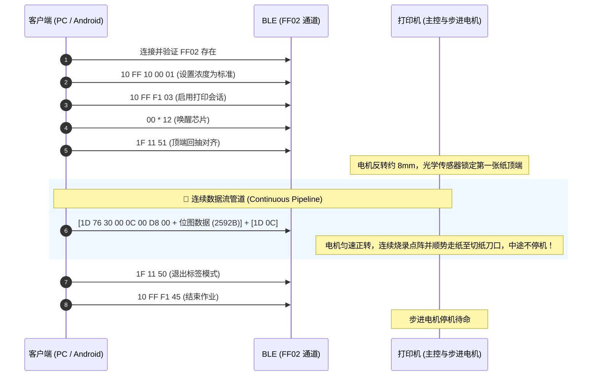

# 得力 Q1A 标签打印机通信协议规范 (Deli Q1A Protocol Specification)

本文档整理自对官方 App（“得力趣贴贴”）与底层动态库的逆向工程，供学习研究、嵌入式开发（ESP32/MCU）及移动端（Android/iOS）移植参考。

---

## 1. 蓝牙低功耗 (BLE) 参数

* **广播设备名**：`Q1A_SS_xxxx`（后 4 位通常对应 MAC 地址末尾）
* **GATT 服务与特征值**：

| UUID | 属性 (Properties) | 用途说明 |
| :--- | :--- | :--- |
| `0000ff00-0000-1000-8000-00805f9b34fb` | Primary Service | 打印机主服务 |
| `0000ff02-0000-1000-8000-00805f9b34fb` | Write Without Response | **数据与控制指令发送通道** |
| `0000ff01-0000-1000-8000-00805f9b34fb` | Notify | 打印机状态通知（电量、缺纸、开盖等） |
| `0000ff03-0000-1000-8000-00805f9b34fb` | Notify | 打印事件通知 |

* **ATT MTU**：协商值为 240 字节（单次免响应写入推荐切片大小为 **200 字节**，切片延时 10~15ms）。

---

## 2. 硬件与耗材物理规格

* **打印分辨率**：203 DPI（8 dots/mm）。
* **有效打印宽度**：96 点（12mm，每行 12 字节）。
* **标准纸张规格**：15mm 宽 $\times$ 30mm 长间隙纸（间隙高度约 2mm）。
* **打印头与撕纸刀距离**：内部热敏打印头位于机壳锯齿刀口**后方约 8~10mm**。

---

## 3. 核心控制指令集

所有指令通过 `FF02` 特征值以小端序或原始字节直接发送：

### 3.1 基础会话指令

| 指令字节 (Hex) | 名称 | 作用说明 |
| :--- | :--- | :--- |
| `10 FF F1 03` | `CMD_ENABLE` | 开启打印会话，激活主控电机供电 |
| `00 00 ... 00` (12字节) | `CMD_WAKEUP` | 发送 12 个空字节唤醒微控制器与热敏驱动芯片 |
| `10 FF 10 00 [val]` | `CMD_DENSITY` | 设置加热浓度：`00`=浅度, `01`=标准(推荐), `02`=深度 |
| `1F 11 51` | `CMD_ALIGN_TOP` | **顶端回抽对齐**：步进电机反转，将标签纸顶端对齐至打印头 |
| `1D 0C` | `CMD_FEED_GAP` | **间隙定位走纸**：步进电机正转，将下一间隙推进至外壳撕纸刀口 |
| `1F 11 50` | `CMD_EXIT_LABEL` | 退出标签纸模式 |
| `10 FF F1 45` | `CMD_FINISH_JOB` | 结束打印作业，电机断电进入低功耗待机 |

### 3.2 光栅图像打印指令 (ESC/POS GS v 0)

打印机支持标准 ESC/POS 点阵光栅格式：

$$\texttt{1D 76 30 00 [xL] [xH] [yL] [yH] [d1 ... dk]}$$

* `1D 76 30 00`：光栅位图指令头（普通模式）。
* `xL, xH`：水平方向字节数（低字节在前，高字节在后）。例如 96 点宽即 $96 / 8 = 12$ 字节 $\rightarrow \texttt{0C 00}$。
* `yL, yH`：垂直方向点数（行数）。例如 216 行 $\rightarrow 216 = \texttt{0xD8} \rightarrow \texttt{D8 00}$。
* `d1 ... dk`：位图单色数据，$k = (xL + xH \times 256) \times (yL + yH \times 256)$ 字节。

> **点阵格式要求**：
> - 1 个字节代表水平方向连续的 8 个物理点。
> - 最高位（MSB，Bit 7）代表最左侧点，最低位（LSB，Bit 0）代表最右侧点。
> - **1 代表黑色点（加热烧录）**，**0 代表白色背景（不加热）**。

---

## 4. 打印时序流程图（一气呵成管道设计）

为避免电机在打印中途停顿，应将光栅数据与 `1D 0C` 走纸指令放入同一连续管道流中发送：

